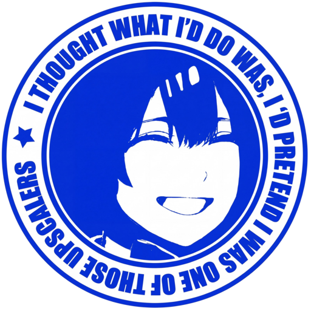
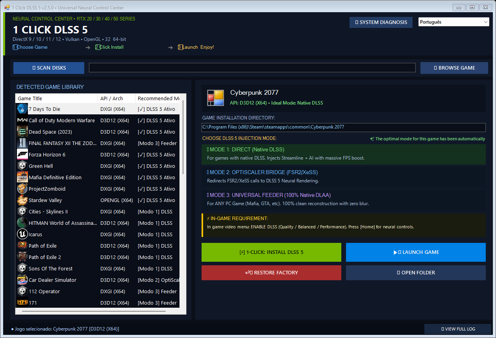
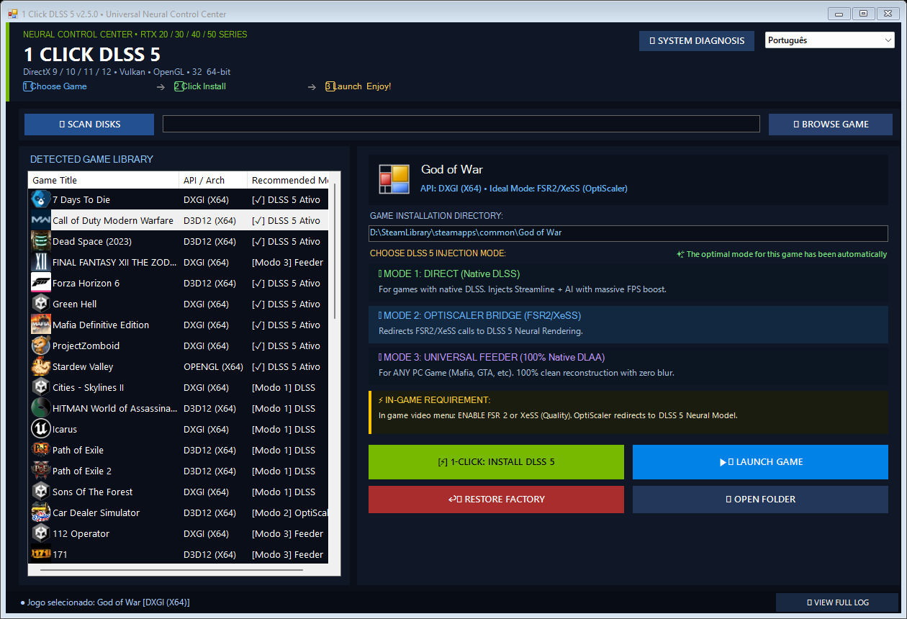
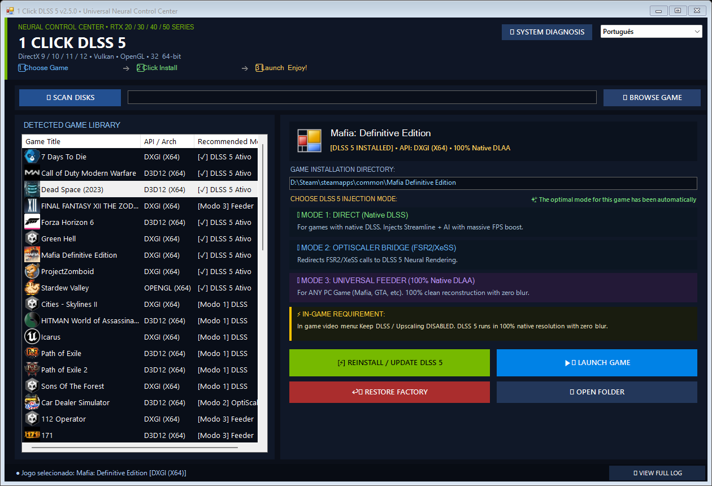

# 1-Click DLSS5: Universal Neural Game Center for Windows 🎮

### ⌨️ PowerShell Command Button

   

---

1-Click-DLSS5 turns any PC game into a neural rendering playground, wrapping game discovery, API detection, and DLSS 5 injection into a single button press so you can spend less time wrestling with proxy DLLs and more time actually playing. Whether your library is stacked with native DLSS titles, FSR/XeSS-only holdouts, or stubborn DX11 classics that never got the upscaler treatment, this toolkit adapts on the fly across RTX 20, 30, 40, and 50 Series hardware. Built for modders who like their tooling as sharp as their shaders, it handles the messy parts — import table inspection, motion vector feeding, clean factory restoration — while leaving every dial exposed for those who want to tinker. Drop in a game folder, pick your mode, and let the neural reconstruction do the heavy lifting.

## ✅ Before You Start

- Windows 10 or Windows 11
- PowerShell 5.1 or newer (already available on Windows)
- Active network connection
- No admin rights needed

## Features

- ⚡ **One-Click Neural Deployment:** Drop in a game, hit the button, and the suite handles API detection, proxy placement, and neural payload selection—no manual file shuffling, no INI archaeology, no late-night DLL hunts.

- 🎮 **Universal Game Center Discovery:** Sweeps your Steam, Epic, GOG, and Xbox libraries plus custom folders across every drive, so your entire collection shows up ready to mod without a single browse dialog.

- 🎯 **Smart Mode Auto-Selection:** Reads each game's binaries like a blueprint, spots native DLSS, FSR, XeSS, or nothing at all, and picks the correct injection path—Direct, Bridge, or Universal Feeder—before you even ask.

- 📂 **Drag & Drop Injection:** Grab any folder or executable straight out of File Explorer and toss it onto the window. Config done in under a second.

- 🩺 **Built-In Diagnostics Suite:** A quick hardware and environment check confirms tensor-capable RTX silicon, write permissions, and runtime health before anything touches your game files.

- ⚡ **1-Click Auto-Fix Engine:** File locks, stubborn read-only folders, lingering background processes—the resolver clears them automatically so you can get back to playing instead of troubleshooting.

- 🌍 **Ten Languages, Zero Reloads:** Full interface translation with instant switching—English, Portuguese (BR), Spanish, German, French, Italian, Japanese, Simplified Chinese, Russian, and Korean all ship in the box.

- 🔄 **Cross-API Interception:** Hooks into DirectX 12, DirectX 11, DirectX 9, Vulkan, and OpenGL so the neural pipeline can reach games no matter which renderer they speak.

- 🧱 **32-Bit Legacy Bridge:** An IPC handshake brings modern 64-bit neural models to aging x86 classics—your old favorites get the same treatment as new releases.

- 🎛️ **Three Injection Flavors:** Direct Mode upgrades native DLSS titles, OptiScaler Bridge reroutes FSR2/XeSS calls into the neural path, and Universal Feeder synthesizes DLAA at 100% native resolution for games with no upscaler at all.

- ↩️ **Surgical Factory Restore:** Uninstalls cleanly while protecting native game binaries and shader libs—your vanilla install stays vanilla, permanently.

- 🖥️ **Silent Native Executable:** A 64-bit compiled binary with a proper Windows manifest, Per-Monitor V2 high-DPI scaling, and zero console flashes—modding that feels like a finished product, not a batch script.

- 🧠 **Modder-Friendly By Design:** Every injection step is inspectable, every log line is readable, and the pipeline respects what other mods have already done—no stomping on your load order.

## Installation

Unpack the archive anywhere on your drive — a dedicated folder like `1-Click-DLSS5` keeps things tidy, and the injector never scatters files across your system. Inside, launch the main executable (`1-Click-DLSS5.exe`); for a completely silent, window-flash-free start, the bundled VBS launcher does the trick. The interface boots straight into its dark-themed game center, and your entire modding session lives inside that single window — no external runtimes, no digging through folders.

From there, the injector does the heavy lifting. Its auto-discovery sweeps your registered game libraries and custom install paths, assembling everything it finds into a clean, Steam-style library view. Spotted your target already? Just drag the game folder or executable straight from File Explorer into the window and it registers instantly. Next, arm the one-click sequence: the engine inspects the binary's import tables, identifies the graphics API and any existing upscaler, and selects the ideal injection mode on its own — Direct for native DLSS titles, the OptiScaler bridge for FSR/XeSS games, and the Universal Feeder for everything else. One confirmation click commits the payload, drops the proxy wrappers in place, and calibrates the neural pipeline.

Before you hit play, a few modder-friendly notes worth tucking away. If Windows has flagged your game folder read-only or a stray background process is clinging to the executable, the built-in auto-fix engine clears both without you lifting a finger — just trigger it from the error prompt and it scrubs the locks, restores write access, and re-applies the injection. When you're ready to test, launch through the game center button so the runtime state stays tracked. And when you want your install pristine again, the surgical restore wipes every injected file while leaving your original game binaries untouched — including protected natives like the Streamline interposers shipped with certain titles. Fresh start, factory clean, every time.

## Compatibility

The beauty of 1-Click-DLSS5 is that it doesn't ask your game library to file paperwork first—it just works. Whether your title shipped with native DLSS, dabbled in FSR or XeSS, or has never heard of an upscaler in its life, the injector reads the binary, picks the right lane, and drives.

**Native DLSS titles** get the VIP treatment through Direct Mode, upgrading standard upscaling into full neural reconstruction with Streamline interposers and the RenoDX add-on. **FSR 2/3 and XeSS-only games** ride the OptiScaler Bridge, where their calls get quietly redirected into the DLSS-NR pipeline without the game ever knowing. And **everything else**—DX11, DX12, Vulkan, OpenGL, even stubborn 32-bit classics—falls into Universal Feeder Mode, where the Lumenite Kernel synthesizes motion vectors and feeds a 100% native DLAA device. Old engines, new engines, Unreal Engine 4 and 5 packaged builds: the auto-detector sorts them out on its own.

API coverage spans DirectX 9 through 12, Vulkan, and OpenGL, with a transparent host64 bridge for legacy x86 executables. RTX 20, 30, 40, and 50 Series cards are all invited to the party. The one thing worth flagging: titles with aggressive anti-cheat may not appreciate a proxy DLL knocking on their door—when in doubt, check before you inject, and lean on the 1-Click Auto-Fix if a file lock or background process tries to play bouncer.

And when you want out? The surgical uninstaller restores your game to factory condition, carefully preserving native binaries like `sl.interposer.dll` and `sl.common.dll` so your original install stays pristine. No leftovers, no scars, no awkward explanations.

## 📸 Screenshot

## Credits

No neural network rises alone. **1-Click DLSS 5** exists because a whole constellation of modders, reverse-engineers, and graphics wizards chose to share their work with the world instead of hoarding it behind closed doors. Every proxy DLL, every optical flow kernel, every tone-mapped pixel in your game traces back to someone who stayed up too late debugging a swapchain. This section is our way of saying: we see you, and we're grateful.

**The ReShade lineage** deserves first mention — the add-on injection runtime that made universal post-processing and synthetic device creation possible in the first place. Without that foundation, half the tricks in this tool would be nothing but wishful thinking and a stack trace.

**RenoDX** carries the neural uplift and HDR torch, proving that a game's rendering pipeline is a suggestion, not a law. Its add-on architecture showed us how far a determined shader can reach into a frame before it gets noticed.

**DLSS5-Feeder** gave us the synthetic D3D12 DLAA device and the universal buffer transport that lets non-DLSS titles drink from the neural well. It is, quite simply, the reason Mode 3 isn't science fiction.

**LumeniteFX** supplied the optical flow motion vector kernel — the high-precision, screen-space heartbeat that keeps motion coherent when the game itself refuses to hand over proper vectors. Clever, elegant, and slightly unreasonable in the best way.

**OptiScaler** (and its DLSS-NR companion work) built the bridge that lets FSR2 and XeSS calls walk across and come out the other side wearing green. Redirection has never felt so seamless.

**NVIDIA** — for the DLSS SDK, Streamline, and the NGX neural rendering stack. We poke, prod, proxy, and occasionally argue with your APIs, but none of it happens without the neural reconstruction model underneath.

**The wider modding community** — the forum lurkers, the DLL-swappers, the people who test on hardware nobody else owns, and everyone who files a bug report with an actual log file attached. You are the QA department, the hype squad, and the reason this project keeps getting sharper. Special thanks to every RTX 20-series owner still squeezing frames out of aging silicon; you keep us honest about compatibility.

**And to the tinkerers reading this:** if you fork it, patch it, or build something stranger on top of it — go wild. That's the whole point. Just remember where the scaffolding came from, and pass the kindness forward.

## License

This project is released under the **MIT License** — the same wide-open, modder-friendly terms that have powered the graphics tinkering community for years. In plain speak: alternative it open, read every line, fork it, remix it, ship it inside your own rig, or build something entirely new on top of it. The only ask is the classic one — keep the copyright notice and permission text intact in anything you redistribute, and don't hold the authors liable if a shader misbehaves at 3 AM.

The full legal text lives in the `LICENSE` file bundled with the project — that document is the authoritative version, and this paragraph is just the friendly summary. If you're planning to bundle 1-Click-DLSS5 into a paid tool, a mod pack, or a custom game center build, you're free to do so under MIT terms; a shout-out in your credits is appreciated but never required.